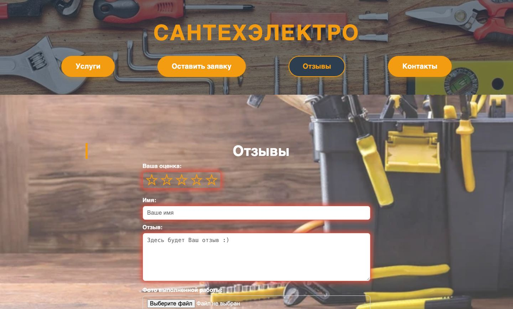

# Сантехэлектро — сайт частного мастера

Сайт для частного мастера (сантехник и электрик) из Краснодара, сделанный для реального заказчика.
Клиент может посмотреть услуги, оставить заявку и написать отзыв. Заявки и отзывы приходят мастеру в Telegram.

## Скриншоты

| Главная | Форма заявки | Отзывы |
|---|---|---|
|  |  |  |

## Возможности

- Страницы: услуги, форма заявки, отзывы, контакты (SPA на Vue Router)
- Форма заявки → уведомление мастеру в Telegram (Telegram Bot API)
- Отзывы с оценкой и фото работы, хранятся в SQLite
- Валидация данных на бэкенде (Pydantic: имя, телефон в формате `+7XXXXXXXXXX`, длина текста, оценка 1–5)
- Ограничение частоты запросов (rate limit → `429 Too Many Requests`)
- Удаление отзывов только с ключом администратора (`X-API-Key`)
- Фильтр нецензурных слов в отзывах
- Секреты (токен бота и т.д.) хранятся в `.env`, а не в коде

## Стек

**Frontend:** Vue 3, Vue Router, JavaScript, HTML, CSS
**Backend:** Python, FastAPI, Pydantic, SQLite, Telegram Bot API
**Вспомогательный сервер:** Node.js, Express (список запрещённых слов)

## Запуск

### 1. Backend (FastAPI)

Создай файл `.env` в корне проекта:
```
TELEGRAM_TOKEN=токен_бота
TELEGRAM_CHAT_ID=id_чата
ADMIN_API_KEY=ключ_администратора
```

Установи зависимости и запусти сервер:
```shell
python -m venv .venv
source .venv/bin/activate
pip install -r requirements.txt
uvicorn main:app --reload
```
API будет доступно на http://127.0.0.1:8000, документация — http://127.0.0.1:8000/docs

### 2. Frontend (Vue)

```shell
npm install
npm run serve
```
Сайт откроется на http://localhost:8080

Запустить фронтенд и Express-сервер вместе:
```shell
npm run dev
```

## Структура

```
├── main.py              # FastAPI: заявки, отзывы, rate limit
├── requirements.txt
├── server/index.js      # Express: фильтр нецензурных слов
└── src/
    ├── pages/           # Services, Reviews, Contacts, админ-страницы
    ├── components/
    └── router/          # маршруты Vue Router
```
